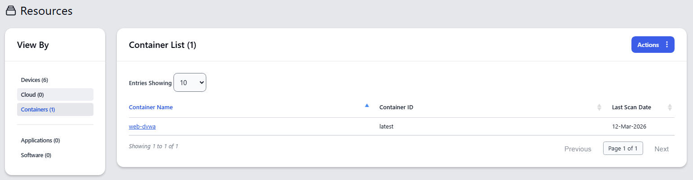
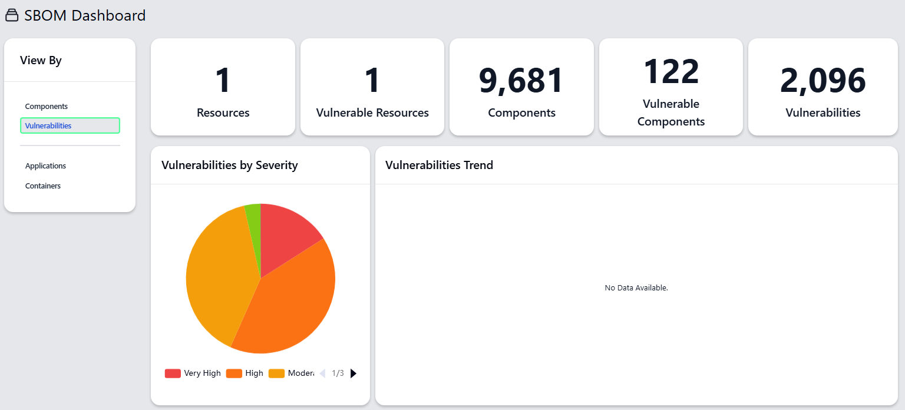

# Bill of Materials

## Upload a Container SBOM
Below is an example for how to create an SBOM using `syft`, scan it for vulnerabilities using `grype`, suppress a specific finding using `vexctl`, and then upload the SBOM to eMASS using `emu`. If you already have a SBOM you want to upload, just skip everything and go to the last step. 

**Step 1.** Pull a container image. 
```bash
docker pull vulnerables/web-dvwa:latest
```

You should get output similar to below. 
```
latest: Pulling from vulnerables/web-dvwa
eb05d18be401: Pull complete 
b3d64a33242d: Pull complete 
e9968e5981d2: Pull complete 
2cd72dba8257: Pull complete 
6cff5f35147f: Pull complete 
098cffd43466: Pull complete 
3e17c6eae66c: Pull complete 
0c57df616dbf: Pull complete 
Digest: sha256:dae203fe11646a86937bf04db0079adef295f426da68a92b40e3b181f337daa7
Status: Downloaded newer image for vulnerables/web-dvwa:latest
docker.io/vulnerables/web-dvwa:latest
```

**Step 2.** Save the digest of the container image to an environment variable called `DIGEST`.
```bash
export DIGEST=$(docker inspect --format='{{index .RepoDigests 0}}' vulnerables/web-dvwa:latest | cut -d":" -f2)
```

**Step 3.** Print the digest of the container image to verify what it is. 
```bash
echo $DIGEST
```

You should get output similar to below. 
```
dae203fe11646a86937bf04db0079adef295f426da68a92b40e3b181f337daa7
```

**Step 4.** Use `syft` to create an SBOM for the container image.
```bash
syft vulnerables/web-dvwa:latest -o json=sbom.json
```

You should get output similar to below. 
```
 ✔ Loaded image                                                                                           vulnerables/web-dvwa:latest 
 ✔ Parsed image                                               sha256:ab0d83586b6e8799bb549ab91914402e47e3bcc7eea0c5cdf43755d56150cc6a 
 ✔ Cataloged contents                                                738614d5cf55eef7c055a83881c558b6fc9188c6da94956da63132c04afff180 
   ├── ✔ Packages                        [221 packages]  
   ├── ✔ Executables                     [1,132 executables]  
   ├── ✔ File metadata                   [9,458 locations]  
   └── ✔ File digests                    [9,458 files]  
```

**Step 5.** Use `grype` to scan the SBOM for vulnerabilities.
```bash
grype sbom.json -o json=raw-scan.json
```

You should get output similar to below. 
```
 ✔ Scanned for vulnerabilities     [2097 vulnerability matches]  
   ├── by severity: 327 critical, 760 high, 700 medium, 99 low, 210 negligible (1 unknown)
   └── by status:   1362 fixed, 735 not-fixed, 0 ignored 
```

**Step 6.** Pick a container image component listed in the SBOM and a vulnerability (e.g., `CVE-2019-11043`) `grype` associated with it that you want to suppress. Then, run `grype` again, but pipe its output to `jq` to get the Package URL its using for the component you want to suppress. 
```bash
grype sbom.json -o json | jq -r '.matches[] | select(.vulnerability.id=="CVE-2019-11043") | .artifact.purl'
```

You should get output similar to below.
```
 ✔ Scanned for vulnerabilities     [2097 vulnerability matches]  
   ├── by severity: 327 critical, 760 high, 700 medium, 99 low, 210 negligible (1 unknown)
   └── by status:   1362 fixed, 735 not-fixed, 0 ignored 
pkg:deb/debian/libapache2-mod-php7.0@7.0.30-0%2Bdeb9u1?arch=amd64&distro=debian-9&upstream=php7.0
pkg:deb/debian/php7.0@7.0.30-0%2Bdeb9u1?arch=all&distro=debian-9
pkg:deb/debian/php7.0-cli@7.0.30-0%2Bdeb9u1?arch=amd64&distro=debian-9&upstream=php7.0
pkg:deb/debian/php7.0-common@7.0.30-0%2Bdeb9u1?arch=amd64&distro=debian-9&upstream=php7.0
pkg:deb/debian/php7.0-gd@7.0.30-0%2Bdeb9u1?arch=amd64&distro=debian-9&upstream=php7.0
pkg:deb/debian/php7.0-json@7.0.30-0%2Bdeb9u1?arch=amd64&distro=debian-9&upstream=php7.0
pkg:deb/debian/php7.0-mysql@7.0.30-0%2Bdeb9u1?arch=amd64&distro=debian-9&upstream=php7.0
pkg:deb/debian/php7.0-opcache@7.0.30-0%2Bdeb9u1?arch=amd64&distro=debian-9&upstream=php7.0
pkg:deb/debian/php7.0-pgsql@7.0.30-0%2Bdeb9u1?arch=amd64&distro=debian-9&upstream=php7.0
pkg:deb/debian/php7.0-readline@7.0.30-0%2Bdeb9u1?arch=amd64&distro=debian-9&upstream=php7.0
pkg:deb/debian/php7.0-xml@7.0.30-0%2Bdeb9u1?arch=amd64&distro=debian-9&upstream=php7.0
```

**Step 7.** Create a VEX document using your product PURL, component PURL, and vulnerability. For products that are containers, the PURL format is `pkg:oci/<image-name>@sha256%<image-digest>?tag=<tag>`. For example, the product PURL for the `latest` tag of the `web-dvwa` container image is `pkg:oci/web-dvwa@sha256:${DIGEST}`.
```bash
vexctl create \
  --product="pkg:oci/web-dvwa@sha256:${DIGEST}" \
  --subcomponents="pkg:deb/debian/libapache2-mod-php7.0@7.0.30-0%2Bdeb9u1?arch=amd64&distro=debian-9&upstream=php7.0" \
  --vuln="CVE-2019-11043" \
  --status="not_affected" \
  --justification="vulnerable_code_not_in_execute_path" \
  --file="vex.json" \
  --author="Vic Fernandez III"
```

**Step 8.** Using the VEX document as additional input, scan the SBOM again to verify the vulnerability gets suppressed. 
```bash
grype sbom.json --vex=vex.json -o cyclonedx-json=updated-sbom.json
```

You should get output similar to below. As you will see, the number of vulnerability matches went down from 2097 to 2096.
```
 ✔ Scanned for vulnerabilities     [2096 vulnerability matches]  
   ├── by severity: 327 critical, 760 high, 700 medium, 99 low, 210 negligible (1 unknown)
```

**Step 9.** Upload the SBOM. 
```bash
./emu upload sbom \
    -containerName web-dvwa \
    -containerIdentifier latest \
    -file updated-sbom.json 
```

In eMASS, you should see something similar to below under Assets > Resources. 



More importantly, your SBOM dashboard will look like this.


